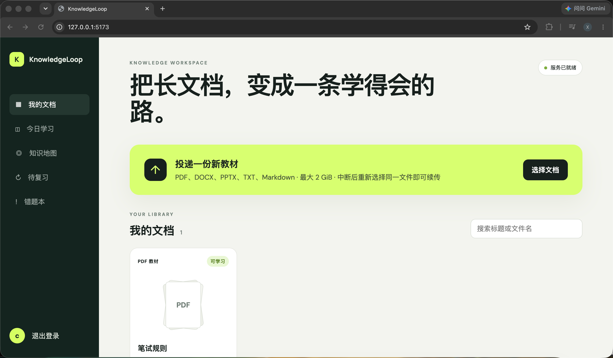
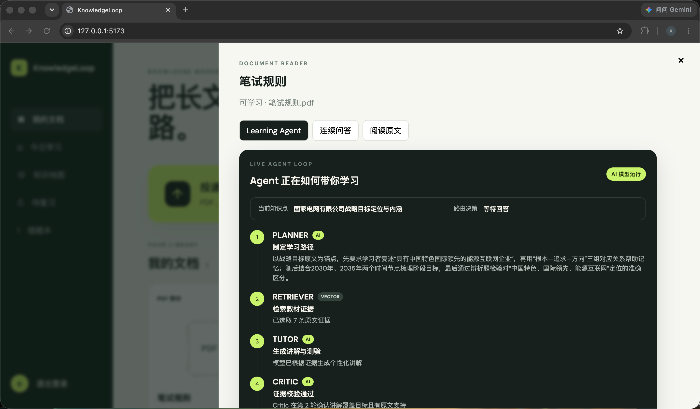
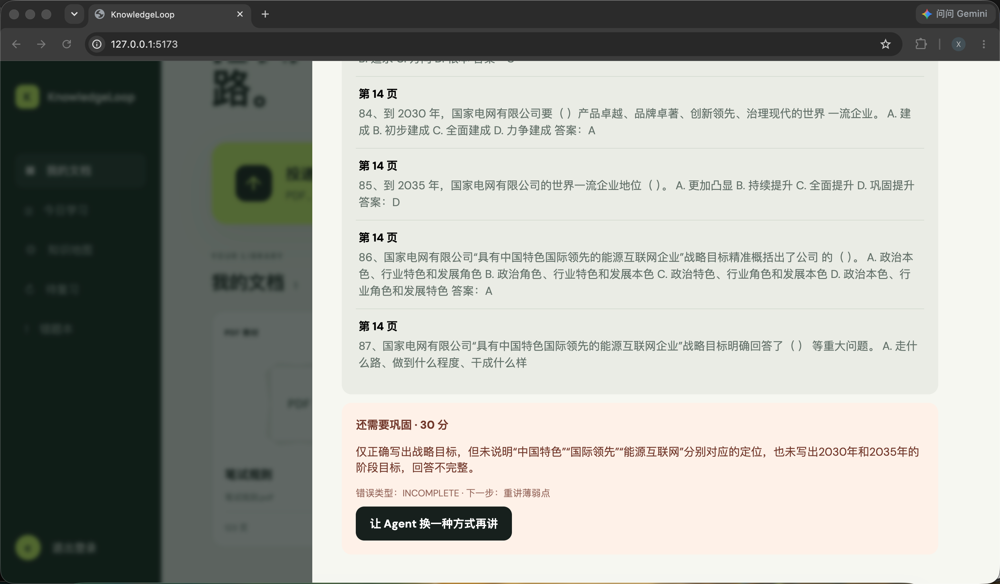
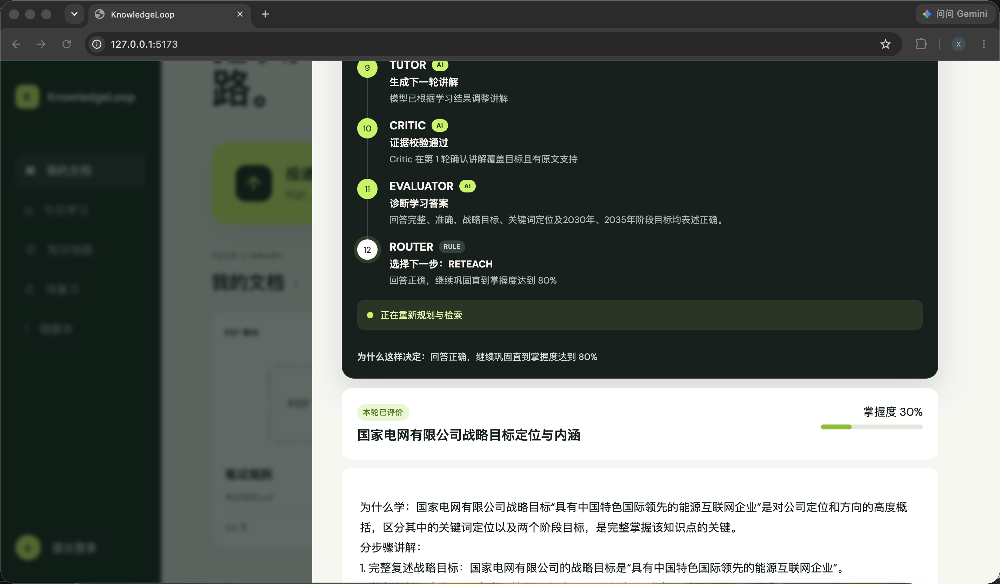
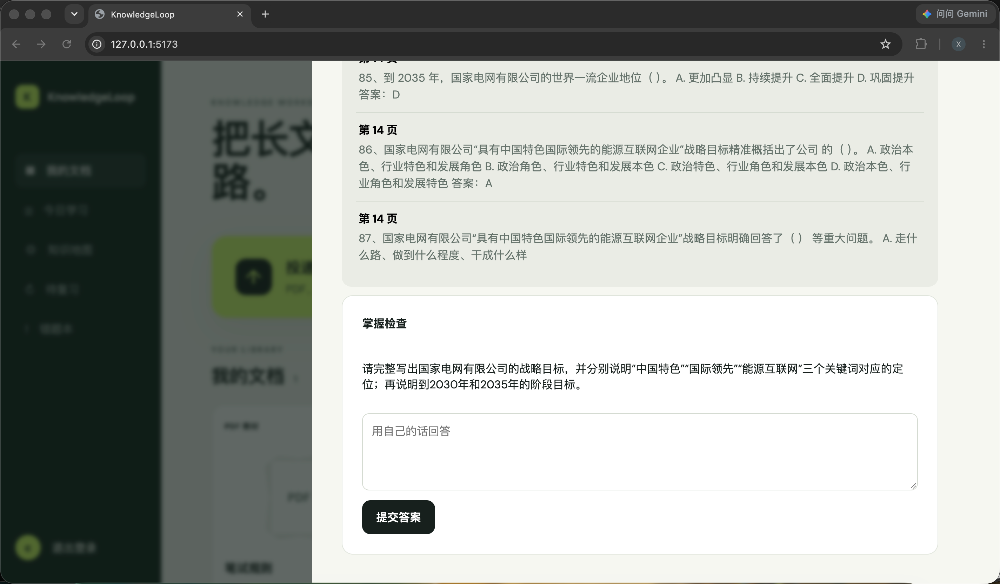
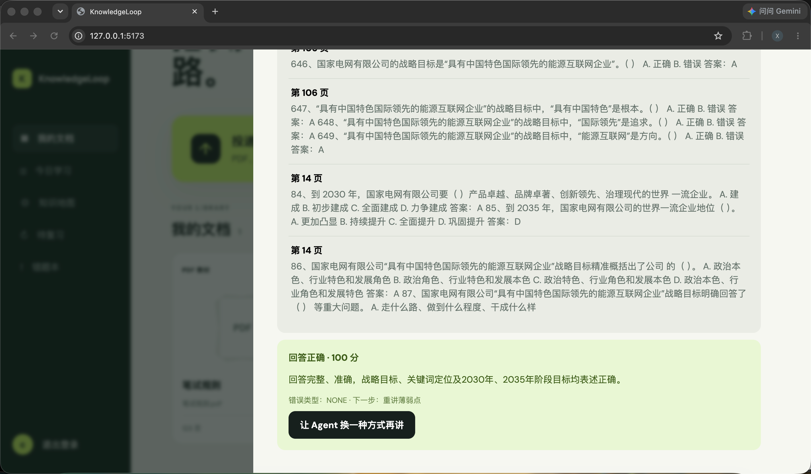
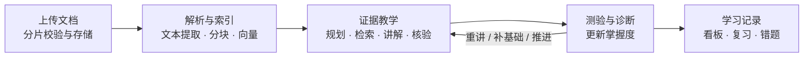
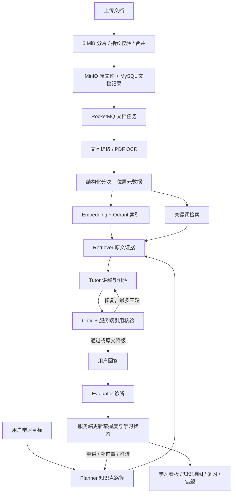

<div align="center">
  <h1>KnowledgeLoop</h1>
  <p><strong>面向长文档深度学习的 Learning Agent</strong></p>
  <p>
    
    
    
    
    <a href="./LICENSE"></a>
  </p>
  <p>将教材、论文和讲义转化为可检索、可追溯的学习材料，<br>通过讲解、测验、诊断与复习形成持续学习闭环。</p>
</div>

## 项目介绍

KnowledgeLoop 以文档原文为依据，帮助用户从“读过材料”走向“掌握知识”。上传文档并设置学习目标后，Agent 制定知识点路径、检索证据、生成讲解和测验，再根据答案决定重讲、补充前置知识或推进学习。

当前前端为文档学习工作台，包含我的文档、今日学习、知识地图、待复习和错题本。后端保留原 DoVideoAI 视频分析模块，作为历史兼容能力；本文以当前文档学习功能为主。

## 项目预览

以下截图展示一次实际的文档学习过程：上传教材、生成教学材料、诊断答案，再根据掌握度继续巩固。

**文档工作台**

上传教材，查看文档状态并进入学习。

<p align="center">
  <a href="docs/images/document-workspace.png"></a>
</p>

**Learning Agent 执行轨迹**

展示 Planner、Retriever、Tutor 和 Critic 的学习规划、原文检索、教学生成与证据核验过程。

<p align="center">
  <a href="docs/images/learning-agent-trace.png"></a>
</p>

**答案诊断与重讲**

回答不完整时，指出遗漏内容、标记错误类型，并提供换一种方式讲解的入口。

<p align="center">
  <a href="docs/images/learning-answer-feedback.png"></a>
</p>

**掌握度更新与下一步决策**

回答正确后更新掌握度。示例中掌握度为 30%，尚未达到 80% 阈值，因此继续巩固当前知识点。

<p align="center">
  <a href="docs/images/learning-mastery-progress.png"></a>
</p>

<details>
<summary>查看更多：原文依据、测验与正确回答反馈</summary>

**原文依据与掌握检查**

展示带页码的教材摘录与 Agent 生成的简答题。

<p align="center">
  <a href="docs/images/learning-quiz.png"></a>
</p>

**正确回答反馈**

测验评分与知识点掌握度分别记录；单次获得 100 分后，仍可能需要继续巩固以达到掌握阈值。

<p align="center">
  <a href="docs/images/learning-correct-answer.png"></a>
</p>

</details>

## 核心功能

### 文档接入与结构化解析

- **多格式解析**：支持 PDF、Markdown、TXT、DOCX 和 PPTX，保留页码、标题路径、幻灯片编号、段落或行号等定位信息。
- **PDF OCR 补充**：对提取文本少于 40 个字符的页面尝试 Tesseract 中英文 OCR；OCR 不可用时保留已有文本，完全无可提取文本的文档会解析失败。
- **断点续传**：前端按 5 MiB 分片，支持暂停后续传、上传状态查询、内容指纹校验和合并幂等。上传会话持久化在 MySQL，分片保存在后端本地目录，原文件存入 MinIO。
- **异步处理**：上传完成后返回 `202 Accepted`，经 RocketMQ 投递解析任务；投递失败时回退到本地异步处理。
- **进度与恢复**：通过 SSE 展示解析进度，持久化阶段 Checkpoint；已有分块时可跳过重复解析并重建索引。

解析状态：

```text
QUEUED → EXTRACTING → CHUNKING → EMBEDDING → READY
                                           └→ READY_WITH_WARNINGS（关键词检索降级）
处理异常 → FAILED
```

### 带原文引用的问答

- **混合检索**：结合关键词匹配与 Embedding/Qdrant 语义召回，选择相关原文分块。
- **连续追问**：单文档问答支持对话历史，回答附带原文摘录和定位信息，前端可点击引用查看对应分块。
- **降级机制**：向量服务不可用时继续使用关键词检索；模型不可用或生成失败时返回 `FALLBACK` 原文证据。
- **课程接口**：后端提供课程创建、文档关联查询与跨文档问答接口，当前前端主要围绕单文档学习展开。

### 双层 Learning Agent Loop

**内层负责教学质量：Planner → Retriever → Tutor → Critic。** Planner 保存有序知识点路径，Tutor 根据计划、原文证据和上轮诊断生成讲解与测验。Critic 检查目标覆盖和语义依据，服务端进一步核验 `documentId`、`chunkId` 及逐字原文引用；最多进行三轮生成/修复，仍不通过时回退到原文摘录并标记 `FALLBACK`。

**外层负责学习推进：回答 → Evaluator → 掌握度更新 → 下一步教学。** 掌握度按用户、文档和稳定知识点键保存，由服务端规则约束，模型不能直接指定最终掌握度或完成动作。

| 诊断结果 | 掌握度变化 |
| :--- | :--- |
| 回答正确且评分 ≥ 0.80 | +0.30 |
| 回答正确且评分 ≥ 0.60、< 0.80 | +0.15 |
| 概念错误 | −0.20 |
| 其他错误 | −0.10 |

掌握度限制在 0–1。回答正确且掌握度达到 0.80 后才能推进知识点；未达标时重讲，前置知识缺失时优先补基础，完成后返回原知识点。前置补充最多嵌套三层并避免循环，知识点路径及返回链完成后才结束会话。当前测验完成后才能生成下一轮，答案提交使用会话版本和幂等键控制重复请求。

这里的“自进化”指根据测验反馈调整学习状态与教学策略，不涉及模型参数训练。`FALLBACK` 下的规则评分基于文本重合，不能替代模型的语义诊断。

### 学习工作台

- 文档列表、搜索、上传进度、后台处理状态与结构化原文阅读。
- 学习目标输入、Agent 执行轨迹、讲解、教材证据、测验和掌握度反馈。
- 今日学习统计、知识地图、待复习条目和错题本。
- 用户注册与登录，以及按用户归属校验文档和学习会话访问。

## 系统流程



<details>
<summary>展开完整系统流程</summary>



</details>

文档解析状态通过 SSE 推送至工作台。MySQL 保存业务记录、分块、上传会话和学习状态，Redis 用于缓存、锁及相关任务事件能力。

## 技术栈

| 层次 | 技术与用途 |
| :--- | :--- |
| 前端 | Vue 3、Vite：文档工作台、原文阅读与学习交互 |
| 后端 | Java 21、Spring Boot 3.5.9、Undertow、MyBatis-Plus |
| 文档解析 | PDFBox 3.0.4、Apache POI 5.4.1、Tesseract |
| AI | LangChain4j 1.16.3、OpenAI 兼容模型接口、BGE-M3 Embedding |
| 数据与存储 | MySQL 8、Flyway、MinIO、Qdrant |
| 异步与缓存 | RocketMQ 5.3.4、Redis 7.4、Redisson |
| 部署 | Docker Compose、Nginx；支持容器部署或本地开发 |

## 本地运行

### 1. 准备配置

在项目根目录执行：

```bash
cp .env.example .env
```

替换 `DB_PASSWORD`、`MYSQL_ROOT_PASSWORD`、`REDIS_PASSWORD`、`MINIO_SECRET_KEY` 和 `QDRANT_API_KEY` 的示例值。全新数据库中，`DB_USERNAME` 与 `MYSQL_APP_USER` 应保持一致。

模型配置分为 LLM 和 Embedding 两组，密钥、地址和模型名称应与各自服务商匹配：

| 配置 | 说明 |
| :--- | :--- |
| `LLM_API_KEY` | 学习规划、讲解、评价和问答使用的模型密钥 |
| `LLM_BASE_URL` / `LLM_MODEL` | OpenAI 兼容接口地址与模型名称；模板当前分别为 `https://api.deepseek.com`、`deepseek-v4-pro`，请按账号实际可用模型设置 |
| `EMBEDDING_API_KEY` | 向量模型密钥 |
| `EMBEDDING_BASE_URL` / `EMBEDDING_MODEL` | 模板为 `https://api.siliconflow.cn/v1`、`BAAI/bge-m3` |
| `SILICONFLOW_API_KEY` | 历史视频 ASR 使用的密钥；相关模型配置未设置时也可作为后备来源 |
| `LLM_TIMEOUT_SECONDS` | 单次模型调用超时，默认 300 秒 |
| `QDRANT_ENABLED` | 是否启用 Qdrant，默认 `true` |

建议显式填写 `LLM_API_KEY` 和 `EMBEDDING_API_KEY`。模板已定义这两个变量为空，不应依赖空字符串自动回退到 `SILICONFLOW_API_KEY`。修改后重启后端；本地密钥不要提交到仓库。

### 2. 选择启动方式

#### 方式 A：Docker Compose

需要 Docker 和 Compose v2。在项目根目录执行：

```bash
docker compose --env-file .env up --build -d
```

Compose 包含前端、后端及 MySQL、Redis、MinIO、Qdrant、RocketMQ，前端经 Nginx 代理文档和学习接口。后端镜像包含文档 OCR 所需 Tesseract 与中文语言包。

- 工作台：`http://localhost:5173`
- 后端健康检查：`http://localhost:9090/health`
- MinIO 控制台：`http://localhost:9001`

查看启动状态与日志：

```bash
docker compose --env-file .env ps
docker compose --env-file .env logs -f server
```

仓库也提供 `./scripts/dev-up.sh` 配置检查脚本。该脚本当前会启动整个 Compose，包括前后端；使用后无需再启动一套本地应用。

#### 方式 B：本地前后端开发

需要 JDK 21、Node.js 22 和 Docker Compose v2。扫描 PDF OCR 还需要本机 `tesseract` 命令及 `chi_sim`、`eng` 语言包；普通文本解析无需 OCR。

只启动中间件，避免与本地应用端口冲突：

```bash
docker compose --env-file .env up -d mysql redis minio qdrant rmqnamesrv rmqbroker
```

在项目根目录加载配置并启动后端：

```bash
set -a
source .env
set +a
cd server
./mvnw spring-boot:run
```

后端通过 Flyway 自动执行 `server/src/main/resources/db/migration/` 中的数据库迁移。另开终端验证：

```bash
curl http://localhost:9090/health
```

成功响应为 `{"code":0,"message":"success","data":"UP"}`。

另开终端，在项目根目录启动前端：

```bash
cd client
npm ci
VITE_API_BASE_URL=http://localhost:9090 npm run dev
```

访问 `http://localhost:5173`。当前 Vite 代理列表尚未包含 `/documents`、`/learning` 和 `/courses`，因此本地开发使用上述 `VITE_API_BASE_URL` 直接访问后端。默认 CORS 允许 `localhost:5173` 和 `127.0.0.1:5173`；若前端更换端口，需要同步调整 `CORS_ALLOWED_ORIGINS`。

### 3. 开始学习

1. 注册或登录账户，上传 PDF、Markdown、TXT、DOCX 或 PPTX。
2. 等待状态变为“可学习”；“可学习 · 关键词检索”表示向量索引降级，仍可使用。
3. 打开文档，输入学习目标，查看 Agent 讲解和原文证据。
4. 回答测验，查看诊断并继续下一步；也可切换到文档问答连续追问。
5. 在今日学习、知识地图、待复习与错题本中查看学习记录。

### 常见问题

| 现象 | 处理方式 |
| :--- | :--- |
| 本地开发登录正常，但文档或学习接口异常 | 使用 `VITE_API_BASE_URL=http://localhost:9090 npm run dev`，并检查后端 CORS |
| 9090 或 5173 端口已占用 | 检查是否已启动 Compose 的 `server`、`client`；本地开发仅启动中间件 |
| MySQL 或 Redis 连接失败 | 检查 Compose 状态与 `.env`；修改环境变量不会自动修改已有 MySQL 数据卷中的账户密码 |
| 文档为 `READY_WITH_WARNINGS` | 检查 Embedding 密钥、模型名称和 Qdrant 配置；当前已降级为关键词检索 |
| 讲解或问答显示 `FALLBACK` | 检查 LLM 密钥、服务地址、模型名称及后端日志；教学引用校验失败也可能触发降级 |
| 扫描 PDF 没有可提取文本 | 确认后端运行环境可执行 `tesseract`，且 `tesseract --list-langs` 包含 `chi_sim` 和 `eng` |
| Maven 提示 `maven-default-http-blocker` | 在 `server` 目录执行 `./mvnw -s .mvn/central-settings.xml spring-boot:run`，使用仓库提供的 Central 配置 |

停止容器：

```bash
docker compose --env-file .env down
```

数据保存在 Compose 命名卷中，普通 `down` 会保留数据。`down --volumes` 会删除数据库、上传分片、对象存储等持久化卷，执行前应备份。

## 主要接口

除健康检查和注册、登录等公开接口外，业务接口需要 `Authorization: Bearer <token>`。JSON 响应采用 `{ code, message, data }`，SSE 使用事件流。

| 方法 | 路径 | 用途 |
| :--- | :--- | :--- |
| GET | `/documents` | 当前用户文档列表 |
| POST | `/documents/init-upload` | 创建或恢复分片上传会话 |
| GET | `/documents/upload-status` | 查询已上传分片 |
| POST | `/documents/upload-chunk` | 上传分片 |
| POST | `/documents/complete-upload` | 校验合并并提交解析 |
| GET | `/documents/{id}/content` | 获取结构化原文分块 |
| GET | `/documents/{id}/process-events` | 订阅文档处理进度 |
| POST | `/documents/{id}/process` | 重新提交处理任务 |
| POST | `/documents/{id}/questions` | 文档问答与连续追问 |
| POST | `/learning/sessions` | 创建学习会话 |
| POST | `/learning/sessions/{id}/answers` | 提交测验答案 |
| POST | `/learning/sessions/{id}/next` | 执行下一步教学 |
| GET | `/learning/sessions/{id}/events` | 学习阶段事件流 |
| GET | `/learning/dashboard` | 学习看板 |
| GET | `/learning/knowledge-map` | 知识点掌握状态 |
| GET | `/learning/review-items` | 待复习条目 |
| GET | `/learning/wrong-answers` | 错题记录 |
| POST | `/courses/{id}/questions` | 课程跨文档问答 |

## 验证与测试

前端测试与构建：

```bash
cd client
npm test
npm run build
```

后端测试（JDK 21）：

```bash
cd server
./mvnw test
```

仅验证双层学习闭环：

```bash
cd server
./mvnw -Dtest=LearningLoopPolicyTest,LearningSessionServiceTest test
```

## 当前边界与历史兼容

- DOCX 当前提取正文段落，PPTX 当前提取文本形状；复杂表格、图片和版式没有完整还原。
- PDF OCR 为低文本页的补充识别，结果受扫描质量和语言包影响。
- 项目预览使用当前文档学习工作台的实际截图；`docs/images/` 中也保留了历史视频界面素材。当前 `App.vue` 未接入旧版 `?demo` 工作台。
- 视频模块保留分片上传、FFmpeg/ASR/OCR、多模态上下文、混合检索及视频 AgentLoop。运行该链路需另外准备 FFmpeg，在线视频解析还需 yt-dlp；当前后端镜像未安装这些工具。
- Compose Broker 当前向客户端通告 `127.0.0.1`，与后端同在容器内运行时需留意 RocketMQ 客户端连接日志；容器内任务投递失败会触发本地异步降级。要验证完整 MQ 链路，可使用本地后端连接中间件，或按部署网络调整 Broker 通告地址。

## 目录结构

```text
KnowledgeLoop-main/
├── client/                       # Vue 文档学习工作台、上传与事件处理
│   ├── src/
│   ├── Dockerfile
│   └── nginx.conf                # 容器前端与 API/SSE 代理
├── server/                       # Spring Boot API
│   ├── src/main/java/            # 文档解析、检索、学习 Agent 与历史视频模块
│   ├── src/main/resources/
│   │   └── db/migration/         # Flyway 数据库迁移
│   ├── src/test/                 # 后端回归测试
│   └── Dockerfile
├── docs/                         # 平台设计、上传实现与历史资料
├── scripts/dev-up.sh             # 本地配置检查与 Compose 启动
├── rocketmq/                     # 历史 Broker 配置
├── docker-compose.yml            # 应用与中间件编排
├── .env.example                  # 环境变量模板
└── LICENSE
```

## 相关文档

- [长文档学习平台设计](docs/long-document-learning-platform-design.md)：平台架构与阶段规划，实际完成情况以当前代码为准。
- [文档断点续传实现说明](docs/document-resumable-upload.md)：上传协议、校验和持久化设计。

## License

本项目基于 [MIT License](LICENSE) 开源。
