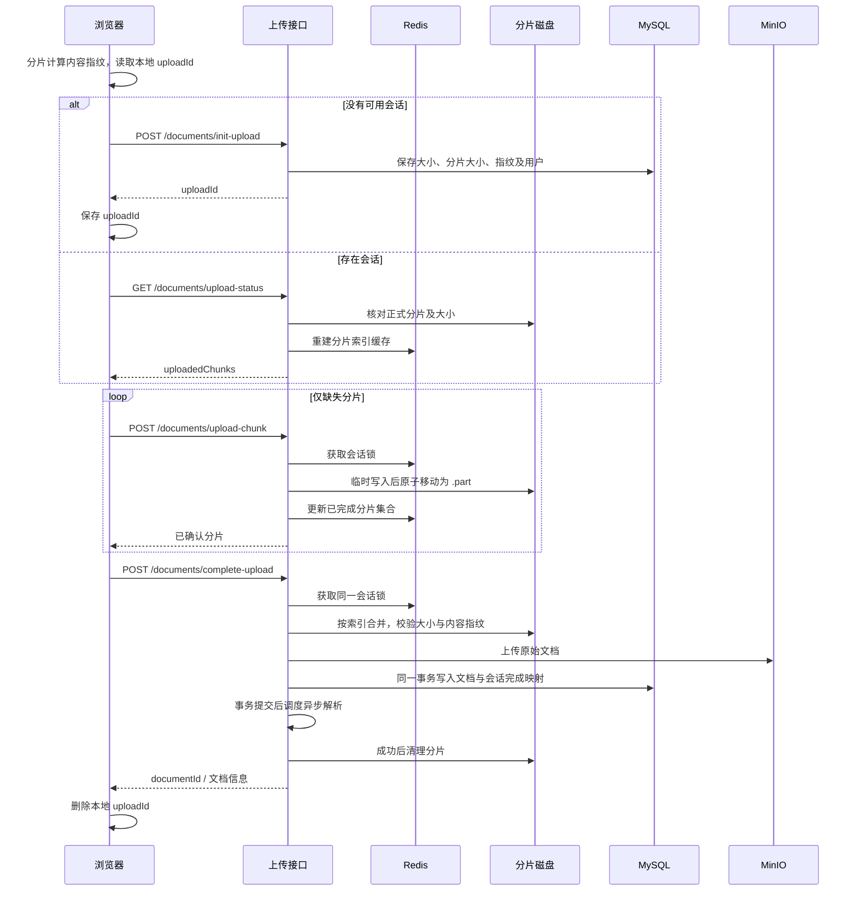

# 文档分片上传与断点续传

## 已实现的使用方式

上传 PDF、DOCX、PPTX、TXT 或 Markdown，前端先校验内容，再以 5 MiB 分片顺序上传（最大 2 GiB）。用户可以暂停，也可以在网络中断或刷新后重新选择同一个文件。客户端重新计算内容指纹，取回同一用户的 uploadId，查询服务端进度，只补传缺失分片。

浏览器只保存会话凭据，不保存文件本体；刷新后需要重新选择文件。浏览器清除本地存储、无痕模式不允许持久化或更换设备后，不能自动找回原会话。

## 链路



## 文件身份与校验

文件名和大小不能唯一识别文件。本实现使用分片内容指纹：

```text
chunkHash[i] = lowercase_hex(SHA256(chunkBytes[i]))
fingerprint = lowercase_hex(SHA256(ASCII(chunkHash[0] + ... + chunkHash[n-1])))
```

每次只读取一个分片到浏览器内存，避免将整个大文件一次性读入。该指纹不是整个文件直接执行 SHA-256 的结果，且与分片边界相关。当前前端固定 5 MiB，服务端将 chunkSize 持久化，并在合并过程中按同样规则计算指纹。

本地凭据键：

```text
document-upload:v1:{userId}:{fingerprint}:{encodedFilename} -> uploadId
```

同一用户、相同内容和相同文件名才复用。不同文件即使同名同大小也不会误续传。身份鉴权由服务端登录态和会话所有者检查保证，客户端传入的指纹不是鉴权凭据。

## 数据归属

| 位置 | 内容 | 生命周期与恢复 |
| --- | --- | --- |
| MySQL upload_sessions | 用户、文件名、大小、分片大小、指纹、进度、完成状态、documentId | 持久保存；完成映射用于幂等返回 |
| Redis Hash `document:upload:{id}` | 用户、总片数、状态 | 缓存 TTL 24 小时；请求刷新 |
| Redis Set `document:upload:{id}:parts` | 已完成分片索引 | 缓存 TTL 24 小时；以正式分片文件重建 |
| Redis/Redisson `lock:document:upload:{id}` | 会话互斥锁 | tryLock；watchdog 续期；finally 释放 |
| 分片目录 | `00000000.part` 等正式分片、临时文件、合并文件 | 成功后清理；普通失败保留 |
| MinIO | 合并后的原始文档 | 由文档管理流程维护 |

Redis 不是文件本体的存储。缓存过期不代表上传会话失效；状态查询在锁内扫描分片文件并重建索引，解决 Redis 丢失、文件写入成功但缓存更新失败的情况。只有原子发布完成且大小正确的 `.part` 文件才会计入进度，遗留 `.tmp` 文件不会计入。

## 接口协议

初始化：`POST /documents/init-upload`

```json
{
  "filename": "book.pdf",
  "mimeType": "application/pdf",
  "totalChunks": 2,
  "totalSize": 6000000,
  "chunkSize": 5242880,
  "fingerprint": "64位小写十六进制内容指纹"
}
```

查询：`GET /documents/upload-status?uploadId=...`

以下为统一响应信封内的 data 示例：

```json
{
  "uploadId": "UUID",
  "status": "UPLOADING",
  "totalChunks": 2,
  "totalSize": 6000000,
  "chunkSize": 5242880,
  "fingerprint": "...",
  "receivedChunks": 1,
  "uploadedChunks": [1]
}
```

`uploadedChunks` 必须是索引列表，不能用 receivedChunks 推算下一片：分片可能乱序到达。完成会话返回 `status=COMPLETED` 和 `documentId`，无需再上传，直接调用完成接口取得原文档。

上传：`POST /documents/upload-chunk?uploadId=...&index=...`，multipart 字段为 `file`。

完成：`POST /documents/complete-upload?uploadId=...`，返回 HTTP 202 及文档信息；表示上传已完成、文档解析异步进行。

## 幂等与失败处理

- 分片写入、状态重建、文件合并使用同一把会话锁，避免合并期间分片被覆盖。不同会话可以并发；同一会话当前串行上传。
- 分片先写唯一临时文件，再原子移动到正式路径；相同索引的重复请求内容一致时复用，内容不一致返回 409，保留原分片。
- 合并逐一检查每个索引及预期大小，按顺序流式写出并校验总大小和指纹，不使用“目录文件数量等于总片数”替代完整性校验。
- MinIO/入库等普通失败保留分片。指纹校验失败时例外：清除不可信分片及缓存索引，保留会话；重新选择同一文件会补传全部分片。
- `DocumentIngestService.completeUpload` 在 Spring 事务中写入文档记录和会话完成映射。完成结果持久化后，重复请求直接查询原文档，避免再次合并、再次调用入库。
- 异步解析在事务提交后派发，避免消费者先于文档入库执行。事务回滚会尝试清理新上传的 MinIO 对象。
- 网络错误、408、429、5xx 最多请求四次，等待间隔为 800/1600/3200 ms。初始化请求不自动重试，避免在响应丢失时不断建立新会话。
- 查询会话只有明确返回 404/410 才丢弃凭据并初始化；401/403/409/5xx、断网或超时不丢弃原凭据。
- 409（会话忙、内容冲突、不完整）不自动重试，用户可重新选择文件继续。暂停使用 AbortController；已保存凭据保留。
- 完成后的临时文件/缓存清理为尽力操作，清理失败不把已提交的成功结果改成失败；再次调用完成接口会再次尝试清理。

## 部署与迁移

Flyway 新增 `V6__resumable_document_upload.sql`，给 upload_sessions 增加 total_size、chunk_size、fingerprint、document_id。旧会话缺少内容指纹，返回 404，前端重新初始化；已有文档不受影响。前后端应一起升级。

分片目录通过 `document.upload.directory` 配置（环境变量 `DOCUMENT_UPLOAD_DIRECTORY`），默认 `./data/document-uploads`。Compose 将其设置为 `/app/data/document-uploads`，挂载 `document-uploads` 命名卷，容器重建后仍可续传。勿使用 `docker compose down -v` 删除需要保留的卷。

浏览器内容校验使用 Web Crypto，需要 HTTPS 或 localhost。若部署到局域网 HTTP 地址，需要配置 HTTPS。

前端 Nginx 的 `client_max_body_size` 已设为 8 MiB，允许 5 MiB 分片及 multipart 开销；外层网关也需要配置足够的请求体上限。

## 实现边界

1. 当前适用于单实例持久磁盘，或多个实例共享同一分片文件系统。不同机器各自独立磁盘不能只靠 Redis 实现跨节点续传；需要共享目录，或进一步改为 MinIO Multipart Upload。
2. Redis 不可用时上传接口失败，不能绕过会话锁继续写入；恢复后可重试。watchdog 不是跨网络分区的严格 fencing 协议。
3. 完成幂等以同一 uploadId 为边界；两个不同会话同时上传相同内容，不承诺严格全局去重。
4. MinIO 与 MySQL 不是分布式事务。进程在对象上传后、数据库提交前崩溃可能遗留孤立对象；普通事务回滚会尽力删除。数据库提交和 MQ 派发之间仍有崩溃窗口，严格可靠派发需要 outbox。
5. MySQL 会话与未完成分片目前没有自动过期清理任务，Redis 的 24 小时仅是缓存 TTL。生产环境需增加按业务保留期清理废弃会话、临时文件和孤立对象的任务，并与会话锁协调。
6. 相同磁盘文件大小不代表内容绝对正确，因此状态接口只做大小检查，最终合并做完整内容指纹验证。磁盘损坏时可能需要重传全部分片。
7. 合并、校验和 MinIO 上传仍在完成请求内执行，不能据此宣称完成接口 P95 为 100 ms。

## 验证

本次验证：后端全量 22 项测试通过，前端全量 9 项测试通过，Vite 生产构建与 Nginx 配置检查通过。上传相关测试使用外部服务替身；尚未执行连接真实 MySQL、Redis、MinIO 的浏览器端到端故障注入测试。

自动测试：

- `client/src/documentUpload.test.js`：跳过已上传片、服务端异常保留凭据、404 重建与 403 保留、完成响应丢失重试、完成会话复用、暂停恢复、同名同大小不同内容。
- `server/src/test/java/com/example/server/service/DocumentIngestServiceTest.java`：实际 Spring 事务代理的提交后派发、会话映射失败回滚及对象清理（事务管理器与外部存储使用测试替身）。
- `server/src/test/java/com/example/server/service/DocumentChunkUploadServiceTest.java`：磁盘进度恢复、重复片与冲突、大小/缺片检查、失败保留、重复完成、内容校验失败、越权与锁冲突、临时文件排除、不完整分片替换。

人工联调步骤：上传超过 10 MiB 的文档，在第一个分片成功后暂停或断网；刷新并重新选择原文件，检查 Network 中只发送缺失索引。完成后重复提交完成请求，应返回同一 documentId。模拟 MinIO 不可用，完成失败后恢复 MinIO，再选同一文件应无需重传分片。重启应用或删除该会话的 Redis 缓存，再查询应恢复磁盘上的分片进度。

## 简历表述

实现文档分片上传与断点续传，通过内容指纹与持久化上传会话识别文件，基于 Redis 维护分片索引和会话锁，支持中断后缺片补传、完整性校验与完成请求幂等，并使用 MinIO 存储原始文档。
