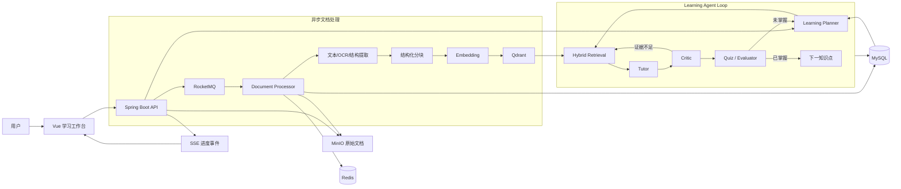
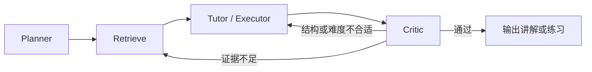
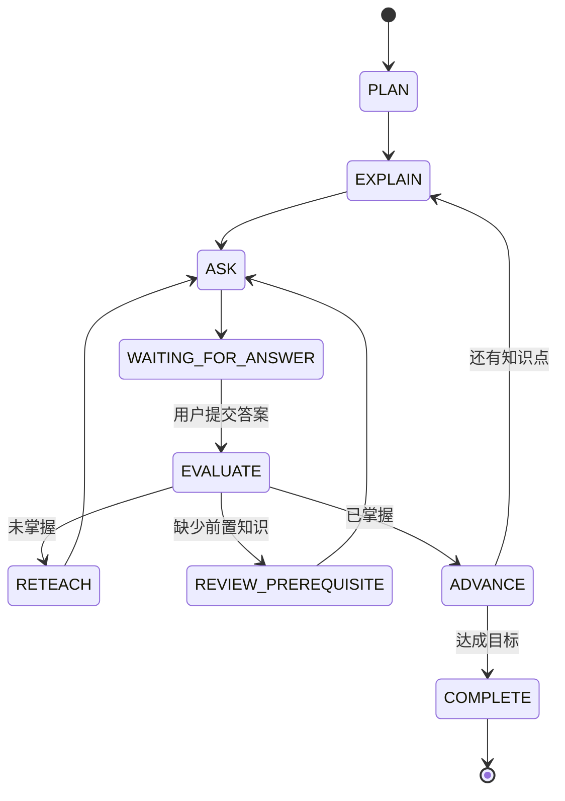

# KnowledgeLoop：异步长文档学习平台设计文档

> 文档状态：Draft  
> 版本：v1.0  
> 日期：2026-09-26  
> 基础项目：DoVideoAI

## 1. 文档目的

本文档描述如何在尽可能复用 DoVideoAI 现有技术栈和工程能力的前提下，将产品演进为 **KnowledgeLoop——异步长文档学习平台**。

目标平台支持用户上传大型 PDF、PPTX、DOCX、TXT 和 Markdown 文件，异步完成内容解析、结构化分块和向量索引，并通过 Learning Agent 为用户提供：

- 文档导学与知识地图；
- 个性化学习计划；
- 分章节讲解和原文溯源；
- 练习、答案评价和错因分析；
- 薄弱知识点补学；
- 跨会话进度记录与复习安排。

RAG 是平台检索教材内容的底层能力，不是产品定位。产品闭环是“规划—教学—测验—评价—调整—继续学习”。

## 2. 背景与问题

长文档学习存在以下困难：

1. 文档体积大，无法一次性放入大模型上下文；
2. PDF、PPTX、DOCX 等格式的结构和引用方式不同；
3. 普通摘要或问答无法判断用户是否真正掌握；
4. 模型回答可能脱离教材，缺少可核验的页码或章节引用；
5. OCR、解析和向量化属于长耗时任务，需要异步执行与断点恢复；
6. 学习过程横跨多次请求甚至多天，不能依赖单个长时间运行的服务线程。

DoVideoAI 已经具备分片上传、MinIO、RocketMQ、Redis、MySQL、Qdrant、SSE、Checkpoint、限流以及 Planner—Executor—Critic 编排，因此适合采用渐进式改造，而不是推翻重写。

## 3. 产品目标与非目标

### 3.1 产品目标

- 支持大型文档分片上传、断点续传和内容去重；
- 支持 PDF、PPTX、DOCX、TXT、Markdown；
- 对扫描版 PDF 使用 OCR，并允许部分页面失败后继续处理；
- 建立可重复使用的文档结构和向量索引；
- 所有教材相关结论均可追溯到原文位置；
- 根据学习目标和用户掌握情况动态调整教学路线；
- 支持异步任务、失败重试、幂等消费和断点恢复；
- 对 Agent 轮次、耗时、Token 和费用设置明确上限。

### 3.2 第一阶段非目标

- 不实现多人实时协作编辑；
- 不实现完整 LMS 教务、排课和考试管理；
- 不承诺还原 DOCX 的视觉页码，因为 DOCX 页码依赖字体、纸张和渲染环境；
- 不在首版实现复杂知识图谱推理；
- 不让 Agent 无限制自主循环；
- 不在首版进行文档内容改写或在线 Office 编辑。

## 4. 设计原则

1. **解析一次，多次学习**：文档解析和索引独立于具体学习目标，避免每次提问重复解析。
2. **工作流与 Agent 分离**：上传、解析、分块和索引是确定性工作流；学习决策才使用 Agent Loop。
3. **证据优先**：讲解、答案和评价必须绑定文档证据；证据不足时明确说明，而不是自由发挥。
4. **结构优先分块**：优先按标题、段落、页码、幻灯片和表格边界分块，不使用纯固定字符切割。
5. **可恢复**：耗时阶段都产生 Checkpoint，失败后从最近成功阶段恢复。
6. **人参与闭环**：外层学习循环由用户回答驱动，系统不占用线程等待用户。
7. **渐进迁移**：第一阶段兼容现有表和接口，稳定后再完成领域命名清理。

## 5. 总体架构

平台分为离线文档处理、在线学习 Agent、基础设施三部分。



### 5.1 两类独立任务

平台必须区分两类任务：

#### 文档入库任务 `DOCUMENT_INGEST`

```text
上传完成 → 文件校验 → 内容解析 → OCR → 结构识别
         → 分块 → 摘要/关键词 → 向量化 → 索引完成
```

该任务与用户的具体学习目标无关，同一文档原则上只执行一次。

#### 学习任务 `LEARNING_STEP`

```text
读取学习状态 → 规划本轮动作 → 检索教材 → 讲解/出题
             → 证据校验 → 保存状态 → 等待用户下一次输入
```

该任务可被重复执行，每次只推进有限的一步或一轮，不让 MQ 消费者等待用户回答。

## 6. 文档处理设计

### 6.1 支持格式

| 格式 | 提取方案 | 稳定引用方式 | OCR |
|---|---|---|---|
| PDF | Apache PDFBox，逐页提取 | 页码 + 页内段落 | 扫描页需要 |
| PPTX | Apache POI | 幻灯片编号 + 元素序号 | 图片型页面可选 |
| DOCX | Apache POI | 标题路径 + 段落编号 | 嵌入图片可选 |
| TXT | 字符集检测后读取 | 行号范围 | 不需要 |
| Markdown | 标题树解析 | 标题路径 + 行号范围 | 不需要 |

Apache Tika 可用于 MIME 检测和通用兜底，但不作为唯一解析器。PDF 页码、PPTX 幻灯片编号和 DOCX 标题层级必须由专用解析器保留。

### 6.2 解析结果模型

```java
public record DocumentContext(
    Long documentId,
    String source,
    String title,
    DocumentType type,
    List<DocumentSegment> segments
) {}

public record DocumentSegment(
    String segmentId,
    String headingPath,
    Integer pageNumber,
    Integer slideNumber,
    Integer paragraphIndex,
    Integer lineStart,
    Integer lineEnd,
    String text,
    List<String> imageRefs,
    List<String> tableRefs
) {}
```

位置字段允许为空，但每个 `DocumentSegment` 必须至少具有一种稳定定位方式。

### 6.3 OCR 策略

- 先判断 PDF 页面是否包含足量可提取文字；
- 仅对文字不足且疑似扫描页的页面进行渲染和 OCR；
- 复用现有 `OcrUtils` 和 OCR 线程池；
- OCR 结果保留页码、置信信息和原始页面图片引用；
- 单页失败不终止整份文档，记录失败页并继续；
- 所有页面均无有效文本时才将文档标记为解析失败。

### 6.4 结构化分块

分块顺序如下：

1. 识别文档标题树；
2. 以章节、页、幻灯片、段落和表格为自然边界；
3. 对过大的自然块按 Token 预算二次拆分；
4. 对过小且同属一个标题的相邻块进行合并；
5. 为跨块上下文保留少量重叠；
6. 每个子块关联父章节摘要。

建议首版参数：

- 子块目标大小：500～800 Token；
- 最大大小：1,000 Token；
- 重叠大小：约 80 Token；
- 表格和代码块尽量保持完整；
- 标题路径复制到每个子块中，但不重复计入原文引用。

### 6.5 内容去重与幂等

- 继续使用文件内容 MD5/SHA-256 作为内容指纹；
- 同一用户上传相同内容时复用已完成解析结果；
- MQ 幂等键使用 `contentHash + taskType + parserVersion`；
- 解析器或分块算法升级时增加 `parserVersion`，允许安全重建索引；
- Qdrant point id 使用稳定的 `documentId:chunkId:embeddingVersion`。

## 7. RAG 设计

### 7.1 定位

RAG 是 Learning Agent 的“查教材”工具。它负责找到原文，不负责决定用户下一步应该学什么。

### 7.2 索引结构

每个 `DocumentChunk` 至少包含：

```json
{
  "chunkId": "doc-18:p32:c4",
  "documentId": 18,
  "fileName": "数据结构教程.pdf",
  "documentType": "PDF",
  "headingPath": ["第四章 树", "4.2 二叉树遍历"],
  "pageNumber": 32,
  "slideNumber": null,
  "paragraphIndex": 4,
  "text": "前序遍历按照根节点、左子树、右子树的顺序……",
  "summary": "介绍二叉树前序遍历顺序",
  "keywords": ["二叉树", "前序遍历"],
  "parserVersion": 1
}
```

MySQL 保存原文块和定位元数据，Qdrant 保存向量及必要过滤字段。MySQL 是证据真源，不能只依赖向量库 payload 保存原文。

### 7.3 检索流程

```text
学习目标/用户问题
    ↓
查询改写：补充当前章节、薄弱点和前置概念
    ↓
关键词召回 + Qdrant 向量召回
    ↓
按 documentId、章节、课程范围过滤
    ↓
融合去重与重排序
    ↓
TopK 原文块
    ↓
父章节扩展与上下文预算裁剪
```

首版继续复用现有关键词与向量混合检索。后续可增加专用 Reranker，但它不是首版阻塞项。

### 7.4 引用与证据校验

统一引用对象：

```java
public record DocumentEvidence(
    Long documentId,
    String chunkId,
    String fileName,
    String headingPath,
    Integer pageNumber,
    Integer slideNumber,
    Integer paragraphIndex,
    Integer lineStart,
    Integer lineEnd,
    String quote,
    String supportedClaim
) {}
```

证据校验至少检查：

- `chunkId` 是否属于当前用户可访问的文档；
- 引用位置是否与原始块一致；
- `quote` 是否确实出现在原文块中；
- 结论是否能由引用内容支持；
- 重要结论是否存在至少一条有效证据。

## 8. Agent Loop 设计

### 8.1 为什么需要双层循环

文档学习包含两个不同周期：

- **内层内容质量循环**：发生在一次 Agent 任务内部，确保讲解可靠、有证据；
- **外层学习掌握循环**：跨用户交互和跨会话运行，根据答题结果调整学习路线。

### 8.2 内层：内容质量循环



#### Planner

- 理解用户本轮目标；
- 将目标拆成不超过限定数量的学习任务；
- 决定需要检索的知识点及前置概念；
- 选择本轮动作，如讲解、出题、复习或推进。

#### Tutor / Executor

- 只基于已检索证据讲解；
- 根据用户水平控制表达难度；
- 提供例子、类比和步骤化推导；
- 生成练习时明确考查知识点。

#### Critic

- 检查原文证据是否真实且足够；
- 检查讲解是否覆盖 Planner 要求；
- 检查是否存在无依据结论；
- 检查讲解难度是否匹配用户状态；
- 未通过时输出定向补检索条件或重写建议。

内层继续采用当前最多两轮的受控策略，并保留耗时、Token 和费用预算。

### 8.3 外层：学习掌握循环



外层循环不能在一个 MQ 消费过程中阻塞等待。系统在 `WAITING_FOR_ANSWER` 状态持久化后结束当前任务；用户提交答案时，再恢复状态并执行下一步。

### 8.4 Learning Agent 状态

```java
public record LearningAgentState(
    Long sessionId,
    Long userId,
    Long documentId,
    String learningGoal,
    LearningPlan plan,
    String currentKnowledgePoint,
    LearningAction nextAction,
    List<DocumentEvidence> evidence,
    LearningMaterial material,
    Quiz currentQuiz,
    List<LearningAttempt> recentAttempts,
    Map<String, Double> masteryScores,
    List<String> weakPoints,
    CriticResult critique,
    int innerRound,
    long version
) {}
```

`LearningAction` 包括：

- `EXPLAIN`：讲解当前知识点；
- `RETRIEVE_MORE`：补充检索证据；
- `ASK_QUESTION`：生成并展示练习；
- `EVALUATE`：评价用户回答；
- `RETEACH`：换一种方式重讲；
- `REVIEW_PREREQUISITE`：回退到前置知识；
- `ADVANCE`：进入下一知识点；
- `REVIEW`：安排复习；
- `COMPLETE`：完成当前学习目标。

`version` 用于乐观锁，避免用户重复提交或并发请求覆盖学习状态。

### 8.5 循环终止条件

内层循环满足任一条件即终止：

- Critic 校验通过；
- 达到最大轮次；
- 达到耗时、Token 或费用上限；
- 无法获取足够文档证据。

外层循环满足任一条件即暂停或终止：

- 本次学习任务中的必学知识点达到掌握阈值；
- 用户完成今日计划；
- 用户主动暂停或结束；
- 等待用户回答；
- 达到单次会话步数上限；
- 系统判断需要人工选择学习方向。

首版可以将掌握阈值设为 `0.8`，但必须通过配置管理，而不是硬编码在提示词中。

## 9. 学习能力设计

### 9.1 文档导学

解析完成后生成：

- 文档简介；
- 章节树；
- 核心概念；
- 概念之间的先修关系；
- 预计难度与建议学习顺序；
- 可能需要外部前置知识的章节。

### 9.2 学习计划

输入：

- 学习目标；
- 用户可用时间；
- 当前基础；
- 目标完成日期；
- 希望的学习深度。

输出：

- 有序知识点；
- 每个知识点对应的文档范围；
- 预计学习时长；
- 讲解、练习和复习任务；
- 完成条件。

### 9.3 章节伴学

- 先说明“为什么要学”；
- 再解释核心概念；
- 提供来自文档的例子；
- 允许用户追问；
- 回答附带页码、幻灯片或章节引用；
- 对超出教材范围的问题明确标记为“扩展知识”。

### 9.4 测验与评价

题型首版支持：

- 单选题；
- 多选题；
- 判断题；
- 简答题；
- 步骤或推导题。

Evaluator 输出：

- 是否正确；
- 得分；
- 正确部分；
- 错误部分；
- 错因类别；
- 关联知识点；
- 建议下一动作；
- 对应教材证据。

### 9.5 掌握度模型

首版使用可解释的简单模型，不引入复杂机器学习：

```text
新知识点初始掌握度 = 0
正确且解释充分      += 0.30
正确但理由不足      += 0.15
提示后正确          += 0.10
概念性错误          -= 0.20
重复同类错误        -= 0.10
```

最终分数限制在 `[0, 1]`。后续可基于真实学习数据调整权重。

## 10. 异步状态机

### 10.1 文档处理状态

```text
UPLOADED
  → QUEUED
  → VALIDATING
  → EXTRACTING
  → OCR_PROCESSING（可选）
  → STRUCTURING
  → CHUNKING
  → EMBEDDING
  → INDEXING
  → READY
```

异常状态：

- `RETRYING`：可恢复失败，正在重试；
- `READY_WITH_WARNINGS`：部分页面解析失败但可学习；
- `FAILED`：达到最大重试次数；
- `DEAD_LETTERED`：毒消息已写入失败主题和失败台账。

### 10.2 学习任务状态

```text
CREATED
  → PLANNING
  → RETRIEVING
  → GENERATING
  → CRITIQUING
  → WAITING_FOR_ANSWER / STEP_COMPLETED
  → EVALUATING
  → REPLANNING
  → COMPLETED
```

### 10.3 SSE 事件

建议统一事件结构：

```json
{
  "taskType": "DOCUMENT_INGEST",
  "resourceId": 18,
  "stage": "EXTRACTING",
  "state": "PROCESSING",
  "progress": 42,
  "message": "正在解析第 84/200 页",
  "traceId": "...",
  "occurredAt": "2026-09-26T10:00:00+08:00"
}
```

进度值必须由已完成工作量计算，不能由前端计时器模拟。

## 11. 数据模型

### 11.1 `documents`

在迁移期可由现有 `media_files` 演进而来。

| 字段 | 用途 |
|---|---|
| `id` | 文档 ID |
| `user_id` | 所属用户 |
| `filename` | 原始文件名 |
| `document_type` | PDF/PPTX/DOCX/TXT/MARKDOWN |
| `mime_type` | 实际 MIME 类型 |
| `status` | 文档处理状态 |
| `file_path` | MinIO 地址 |
| `content_hash` | 内容指纹 |
| `parser_version` | 解析版本 |
| `title` | 解析出的标题 |
| `outline_json` | 章节树 |
| `page_count` | PDF 页数或 PPT 页数 |
| `warning_json` | 部分解析失败信息 |
| `created_at` | 上传时间 |
| `updated_at` | 更新时间 |

### 11.2 `document_chunks`

| 字段 | 用途 |
|---|---|
| `id` | 主键 |
| `document_id` | 文档 ID |
| `chunk_key` | 稳定块标识 |
| `heading_path` | 标题路径 JSON |
| `page_number` | PDF 页码 |
| `slide_number` | PPTX 幻灯片编号 |
| `paragraph_index` | 段落序号 |
| `line_start/end` | 文本行号 |
| `content` | 原始文本 |
| `summary` | 块摘要 |
| `keywords_json` | 关键词 |
| `content_hash` | 块内容指纹 |
| `embedding_version` | 向量版本 |

### 11.3 `learning_sessions`

| 字段 | 用途 |
|---|---|
| `id` | 学习会话 ID |
| `user_id` | 用户 ID |
| `document_id` | 当前文档 ID |
| `goal` | 学习目标 |
| `status` | 会话状态 |
| `current_knowledge_point` | 当前知识点 |
| `next_action` | 下一动作 |
| `state_json` | Agent 完整状态 |
| `version` | 乐观锁版本 |
| `created_at/updated_at` | 时间字段 |

### 11.4 `knowledge_mastery`

| 字段 | 用途 |
|---|---|
| `user_id` | 用户 ID |
| `document_id` | 文档 ID |
| `knowledge_key` | 稳定知识点标识 |
| `mastery_score` | 0～1 掌握度 |
| `weakness_json` | 薄弱点 |
| `next_review_at` | 下次复习时间 |
| `updated_at` | 更新时间 |

### 11.5 `quiz_attempts`

保存题目、用户答案、标准答案、评价、得分、关联知识点和证据。用户答案属于业务真源，不能只存于 Agent Checkpoint。

### 11.6 Checkpoint 复用

现有 `agent_checkpoints` 继续使用，但 `checkpoint_key` 增加任务域：

```text
document:context
document:chunks:v1
document:index:v1
learning:{sessionId}:plan
learning:{sessionId}:state:{version}
learning:{sessionId}:critic:{step}
```

## 12. API 草案

### 12.1 文档接口

```text
POST   /documents/init-upload
GET    /documents/upload-status
POST   /documents/upload-chunk
POST   /documents/complete-upload
GET    /documents
GET    /documents/{id}
DELETE /documents/{id}
POST   /documents/{id}/process
GET    /documents/{id}/process-status
GET    /documents/{id}/process-events
GET    /documents/{id}/outline
GET    /documents/{id}/content?locator=...
GET    /documents/{id}/preview
```

`complete-upload` 完成后自动投递解析任务，并返回 `202 Accepted` 或包含异步任务状态的文档对象。

### 12.2 学习接口

```text
POST /learning/sessions
GET  /learning/sessions/{id}
POST /learning/sessions/{id}/next
POST /learning/sessions/{id}/answers
POST /learning/sessions/{id}/questions
POST /learning/sessions/{id}/pause
POST /learning/sessions/{id}/resume
GET  /learning/sessions/{id}/events
GET  /learning/sessions/{id}/progress
GET  /learning/sessions/{id}/review-items
```

示例：创建学习会话。

```json
{
  "documentId": 18,
  "goal": "掌握第四章二叉树并能独立完成遍历题",
  "level": "BEGINNER",
  "dailyMinutes": 30,
  "targetDate": "2026-10-10"
}
```

### 12.3 幂等与并发

- 上传接口沿用 `uploadId`；
- 解析接口以 `documentId + parserVersion` 幂等；
- 学习推进接口要求 `sessionVersion` 或 `Idempotency-Key`；
- 重复答案提交返回已生成的评价，不重复更新掌握度；
- 每个学习会话使用短时分布式锁防止并发推进。

## 13. 现有代码迁移映射

| 现有模块 | 目标模块 | 复用程度 | 主要修改 |
|---|---|---:|---|
| `ChunkUploadService` | 保持或改名 `DocumentUploadService` | 高 | 文件类型和大小校验 |
| `MediaIngestService` | `DocumentIngestService` | 高 | 删除 yt-dlp，记录文档类型 |
| `MediaService` | `DocumentService` | 中 | 去除视频播放与关键帧清理 |
| `VideoContextService` | `DocumentParsingService` | 低 | 用文档解析/OCR 替换 FFmpeg/ASR |
| `VideoContext` | `DocumentContext` | 低 | 时间字段改为文档定位字段 |
| `VideoChunkingService` | `DocumentChunkingService` | 中 | 从五分钟分块改为结构化分块 |
| `VideoEvidenceRetrievalService` | `DocumentRetrievalService` | 中高 | 过滤字段和证据对象调整 |
| `LongVideoContextService` | `LongDocumentContextService` | 中高 | 时间范围改为章节范围 |
| `AgentLoopService` | `LearningAgentLoopService` | 高 | 增加 Tutor/Evaluator 和学习动作 |
| `EvidenceVerificationService` | `DocumentEvidenceVerificationService` | 中 | 校验页码、章节、原文引用 |
| `AnalysisDispatchService` | `TaskDispatchService` | 高 | 增加任务类型 |
| `VideoAnalysisConsumer` | `DocumentTaskConsumer` | 高 | 替换处理阶段，保留重试与毒消息收敛 |
| `TaskEventService` | 保持 | 高 | 扩展事件域和阶段 |
| `AgentCheckpointService` | 保持 | 高 | 扩展 checkpoint key |
| `AgentTelemetry` | 保持 | 高 | 增加解析页数、命中率、掌握度指标 |

### 13.1 推荐迁移方式

第一阶段不必立即重命名所有数据库表和 API。可以：

1. 在 `media_files` 增加 `resource_type` 和文档字段；
2. 新接口使用 `/documents`，内部暂时调用已有上传服务；
3. 新旧 DTO 并存，禁止让 `DocumentContext` 继承视频时间戳语义；
4. 文档主流程稳定后再通过 Flyway 完成表名和代码命名迁移；
5. 删除视频能力前先保留一个版本的只读兼容，避免历史数据无法访问。

## 14. 前端设计

### 14.1 信息架构

```text
我的文档
├── 处理中
├── 可学习
└── 解析失败

我的学习
├── 今日任务
├── 继续学习
├── 知识地图
├── 待复习
└── 错题本
```

### 14.2 学习工作台

桌面端推荐三栏：

```text
左侧：章节树/学习计划
中间：Tutor 讲解、提问与练习
右侧：原文证据、PDF 页面或幻灯片预览
```

点击引用时：

- PDF 跳转到对应页；
- PPTX 跳转到对应幻灯片；
- DOCX 定位标题和段落；
- Markdown/TXT 定位标题或行号。

### 14.3 上传体验

- 保留现有 5 MB 分片上传与进度条；
- 接受 `.pdf/.pptx/.docx/.txt/.md`；
- 前端扩展名校验仅用于体验，后端必须再次校验 MIME 和文件头；
- 上传完成后立即进入文档列表，解析过程通过 SSE 更新；
- 允许用户离开页面，稍后回来继续查看处理进度。

## 15. 安全与隐私

- 所有文档、分块、学习会话和引用接口必须校验资源归属；
- MinIO 默认私有桶，通过后端授权或短期签名 URL 访问；
- 禁止根据文件名判断文件类型，必须校验 MIME 和魔数；
- 限制压缩包、嵌入对象和异常大页面，防止解析炸弹；
- 解析器在受限临时目录工作，任务结束后清理；
- 日志不记录完整文档内容、用户答案或学习目标；
- 删除文档时同步删除 MinIO 文件、MySQL 块、Qdrant 向量和相关缓存；
- 对提示注入文本视为文档内容，不把文档中的“指令”提升为系统指令；
- Agent 只能通过受控检索工具访问当前用户授权范围内的文档。

## 16. 性能、可靠性与降级

### 16.1 并发控制

- 文档解析、OCR、Embedding 和交互式 Agent 使用独立有界线程池；
- OCR 与 Embedding 分别设置用户级和全局并发上限；
- 大文档解析按页批处理，避免一次加载整份文件；
- 对相同内容指纹加分布式锁，防止重复解析。

### 16.2 降级策略

- Qdrant 不可用：退化为 MySQL/内存关键词检索；
- Embedding 不可用：完成文本解析并标记索引待补偿；
- 部分页面 OCR 失败：生成 `READY_WITH_WARNINGS`；
- Agent 不可用：仍允许用户浏览文档结构和原文；
- Critic 达到轮次上限：返回带警告结果，不伪装成完全可信；
- SSE 断开：客户端通过状态查询接口恢复。

### 16.3 Checkpoint 粒度

文档处理至少按以下阶段保存：

- 文件验证完成；
- 已解析页码/幻灯片范围；
- 结构提取完成；
- 分块完成；
- 已向量化块集合；
- Qdrant 索引完成；
- 导学结果完成。

## 17. 可观测性

### 17.1 指标

文档处理：

- 上传大小与耗时；
- 解析页数、成功页数和失败页数；
- OCR 调用次数、失败率和平均耗时；
- 文档块数量与平均 Token；
- Embedding 调用量、失败率和成本；
- 索引耗时、重试次数和 Checkpoint 命中率。

学习 Agent：

- 每轮检索命中数；
- 引用有效率；
- Critic 首轮通过率；
- 平均 Agent 轮数；
- 单学习步骤 Token、耗时和费用；
- 用户答题正确率和知识点掌握度变化；
- RETEACH、REVIEW_PREREQUISITE 的触发率。

### 17.2 Trace

每个文档任务和学习步骤生成 `traceId`，贯穿：

```text
HTTP 请求 → MQ 消息 → 解析器 → Embedding → Qdrant
          → Planner → Retrieval → Tutor → Critic → Evaluator
```

## 18. 测试策略

### 18.1 单元测试

- 每种格式的定位信息是否稳定；
- 分块是否尊重标题、表格和最大 Token；
- 引用文本是否能在原文块中找到；
- 学习动作状态机是否合法；
- 掌握度计算是否可重复；
- 幂等键和 Checkpoint key 是否稳定。

### 18.2 集成测试

- 分片上传 → MinIO → MQ → 解析 → Qdrant 全链路；
- MQ 重投不会重复创建块或更新掌握度；
- Qdrant 不可用时能够降级；
- SSE 断线重连后状态一致；
- 用户不能访问其他用户的文档块和引用。

### 18.3 Agent 评测集

为每种格式准备小型黄金数据集，包含：

- 问题与应命中的原文块；
- 正确引用位置；
- 可接受答案要点；
- 不应回答的无证据问题；
- 初学者和进阶用户对应的讲解标准；
- 常见错误答案及期望错因分类。

核心评测指标：Recall@K、引用准确率、无依据结论率、目标覆盖率和学习动作合理率。

## 19. 分阶段实施计划

### Phase 1：文档异步入库

- 支持 PDF、TXT、Markdown；
- 复用分片上传、MinIO、MQ、Redis、Checkpoint 和 SSE；
- 实现 `DocumentContext`、结构化分块和 Qdrant 索引；
- 实现文档列表、处理进度和错误展示。

验收标准：100～300 页文本型 PDF 能异步处理，刷新页面后仍能查看真实进度，失败可从 Checkpoint 恢复。

### Phase 2：有证据的学习 Agent

- 改造 Planner—Executor—Critic；
- 实现混合检索和文档引用；
- 生成导学、学习计划、章节讲解和自测题；
- 前端支持点击引用跳转 PDF 页码。

验收标准：核心结论均有有效引用；证据不足时 Agent 能补检索或明确拒答。

### Phase 3：外层掌握循环

- 增加学习会话、答案提交和 Evaluator；
- 保存掌握度、薄弱点和错题；
- 支持 RETEACH、REVIEW_PREREQUISITE、ADVANCE；
- 支持跨会话恢复。

验收标准：用户答错后系统能基于错因调整下一动作，重新登录后可从原学习位置继续。

### Phase 4：格式与体验完善

- 增加 DOCX、PPTX 和扫描 PDF；
- 增加多文档课程；
- 增加复习计划、闪卡和知识地图；
- 根据评测数据优化 Rerank、分块和掌握度模型。

## 20. 关键风险与应对

| 风险 | 影响 | 应对 |
|---|---|---|
| DOCX 页码不稳定 | 引用跳转不准确 | 使用标题路径和段落编号，不承诺页码 |
| 扫描 PDF OCR 成本高 | 处理慢、资源占用高 | 仅 OCR 无文本页，限制并发并按页恢复 |
| 文档结构识别错误 | 分块和学习计划质量下降 | 保留页/段落定位，允许用户查看原文 |
| 模型生成无依据内容 | 误导学习 | 强制证据对象、程序校验和 Critic 闭环 |
| 外层 Loop 无限运行 | 成本不可控 | 每步有限动作、等待用户、掌握阈值和预算终止 |
| 重复提交答案 | 掌握度被重复更新 | Idempotency-Key、状态版本和唯一约束 |
| Qdrant 数据漂移 | 引用与原文不一致 | MySQL 作为证据真源，索引携带版本 |

## 21. 首版推荐裁剪

为了尽快形成可用闭环，首版只实现以下路径：

```text
上传 PDF/TXT/Markdown
  → 异步解析与索引
  → 生成章节树
  → 用户填写学习目标
  → Agent 制定学习计划
  → 讲解一个知识点
  → 用户完成一道题
  → 评价并更新掌握度
  → 决定重讲或进入下一知识点
```

首版暂不加入复杂知识图谱、多人课程、DOCX 视觉页码还原和自动生成整套考试。先验证“用户是否愿意沿着 Agent Loop 持续学习”，再扩展外围能力。

## 22. 成功判定

平台上线后的核心成功标准不是“回答了多少问题”，而是：

- 用户能否完成一份长文档的结构化学习；
- Agent 能否根据学习表现改变后续教学动作；
- 每个关键讲解能否追溯到文档原文；
- 用户暂停后能否可靠恢复；
- 同一文档是否只解析一次并被多次学习复用；
- 系统是否能在明确的延迟、Token 和费用预算内完成闭环。
